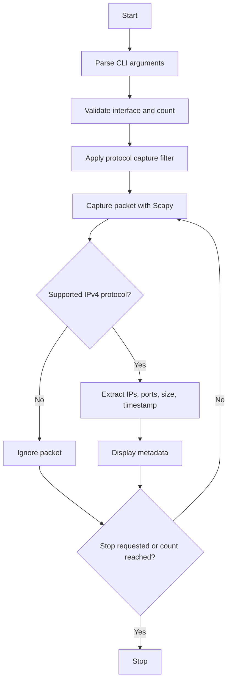

# Basic Network Sniffer — Network Traffic Analysis Tool

A beginner-friendly Python command-line tool that passively captures IPv4 packets and displays metadata for TCP, UDP, and ICMP traffic. It is designed for learning TCP/IP fundamentals and troubleshooting in an authorized lab.

> **Authorization:** Use only on systems and networks you own or have explicit permission to monitor. Packet capture may require administrator/root privileges.

## Features

- Live packet capture through Scapy
- IPv4 source and destination addresses
- TCP/UDP source and destination ports
- ICMP identification (ports shown as `N/A`)
- Protocol filtering: `all`, `tcp`, `udp`, `icmp`
- Interface listing and selection
- Packet-count limit
- Timestamp and packet size
- Unit tests using synthetic packets; tests do not capture or transmit traffic

## Requirements

- Python 3.10 or newer recommended
- Kali Linux or another compatible Linux distribution
- Scapy
- Packet-capture privileges for live capture

## Project layout

```text
basic-network-sniffer/
├── sniffer.py
├── requirements.txt
├── README.md
├── LICENSE
├── .gitignore
├── tests/
│   └── test_sniffer.py
└── screenshots/
    └── README.md
```

## Install on Kali Linux

The distribution package is usually the simplest option:

```bash
sudo apt update
sudo apt install -y python3-scapy
```

Check Scapy:

```bash
python3 -c "from scapy.all import sniff; print('Scapy installed successfully')"
```

Alternatively, use a virtual environment if your Python setup supports it:

```bash
sudo apt install -y python3-venv
python3 -m venv .venv
source .venv/bin/activate
python -m pip install --upgrade pip
python -m pip install -r requirements.txt
```

Do not use `sudo pip` or force-install packages into Kali's externally managed system Python.

## Usage

Run from the project directory.

List interfaces:

```bash
sudo python3 sniffer.py --list-interfaces
```

Capture supported protocols on the default interface:

```bash
sudo python3 sniffer.py
```

Capture only TCP, UDP, or ICMP:

```bash
sudo python3 sniffer.py --protocol tcp
sudo python3 sniffer.py --protocol udp
sudo python3 sniffer.py --protocol icmp
```

Capture up to 20 packets:

```bash
sudo python3 sniffer.py --count 20
```

Select a specific interface (replace `eth0` with a name shown by `--list-interfaces`):

```bash
sudo python3 sniffer.py --interface eth0 --protocol tcp
```

Stop an unlimited capture with `Ctrl+C`.

## Example output

The values below are illustrative, not results from a real capture:

```text
====================================================================
BASIC NETWORK SNIFFER
====================================================================
Interface   : lo
Protocol    : ICMP
Packet limit: Unlimited
Press Ctrl+C to stop. Capture only authorized traffic.
====================================================================
--------------------------------------------------------------------
Time        : 2026-10-24 18:30:12 IST
Protocol    : ICMP
Source IP   : 127.0.0.1
Destination : 127.0.0.1
Source Port : N/A
Dest Port   : N/A
Packet Size : 84 bytes
```

## Safe lab testing

Open two terminals. In terminal 1, list interfaces and start the sniffer on the appropriate interface:

```bash
sudo python3 sniffer.py --list-interfaces
sudo python3 sniffer.py --interface lo --protocol icmp
```

In terminal 2, generate local ICMP traffic:

```bash
ping -c 4 127.0.0.1
```

For TCP traffic, use an interface that can see the traffic and make an ordinary HTTPS request:

```bash
curl --head https://example.com
```

For DNS, run:

```bash
nslookup example.com
```

DNS commonly uses UDP, but may use TCP in some situations. Localhost traffic normally appears on `lo`; traffic to other machines uses a different interface. Do not assume a capture will see traffic that is not visible to the selected interface.

## Tests

Tests build synthetic Scapy packets and do not need root privileges or live network access.

With Scapy installed:

```bash
python3 -m unittest discover -s tests -v
```

## Architecture



## Limitations

- This version analyzes IPv4 TCP, UDP, and ICMP metadata only.
- It does not decrypt HTTPS/TLS traffic.
- It does not capture every packet on a switched network; visibility depends on the interface, network topology, permissions, and capture configuration.
- The timestamp is the time the packet callback processes the packet, not necessarily a hardware capture timestamp.
- It does not save PCAP files or inspect application payloads.
- BPF capture filters require compatible packet-capture support. If unavailable, the program reports the capture error.

## Troubleshooting

**Permission denied:** Run live capture with `sudo` on Linux.

**Interface not found:** Run `sudo python3 sniffer.py --list-interfaces` and copy an exact interface name.

**No packets appear:** Confirm the correct interface and protocol, generate test traffic, and check your lab/network setup.

**BPF filter error:** Check that libpcap/BPF support is installed and available in the environment.

**Scapy missing:** Install `python3-scapy` through Kali's package manager or install requirements in a virtual environment.

## Future enhancements

- CSV/JSON metadata export
- Protocol counters and traffic summaries
- Optional time-based capture duration
- IPv6 support
- PCAP export (with explicit user configuration)
- Optional graphical interface

## Resume description

**Basic Network Sniffer — Python, Scapy, TCP/IP, Linux**
- Built a Python-based packet sniffer to inspect IPv4 traffic and display source/destination addresses, ports, protocol types, timestamps, and packet sizes.
- Implemented TCP, UDP, and ICMP filtering with interface selection and configurable packet limits.
- Tested packet parsing using synthetic unit tests and documented authorized lab validation procedures.

Only list testing and features you have personally verified.

## GitHub publishing

Create an empty repository on GitHub, then run:

```bash
git init
git add .
git commit -m "Build basic network sniffer"
git branch -M main
git remote add origin https://github.com/YOUR_USERNAME/basic-network-sniffer.git
git push -u origin main
```

Replace `YOUR_USERNAME` with your GitHub username. If Git asks for identity, configure your name and email using `git config --global user.name` and `git config --global user.email`.
